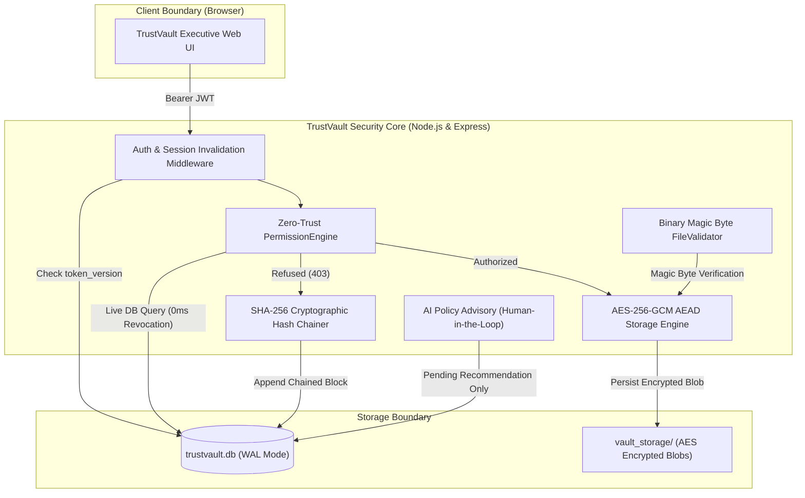

# TrustVault — Secure Document Sharing with an Evidentiary Audit Trail

> **RISE Challenge Submission — Seven-Day Security Architecture Challenge**  
> *"Build a document platform where the wrong person can never read the file, and you can prove who read it."*

[](#)
[](#)
[](#)
[](#)

---

## 1. The Situation & Core Mission

Every enterprise shares confidential documents: salary matrices with executives, contracts with customers, blueprints with engineering partners, and audit papers with regulators. Two failure modes dominate, and both cause catastrophic liability:
1. **Permission Leaks:** Folder-level over-sharing, departing employee links that linger, client cross-visibility.
2. **Repudiation & Evidentiary Failure:** When a confidential document leaks, nobody can prove who opened it, when, and whether unauthorized probes were repelled. An audit trail that can be quietly altered in a database is not evidence in court or regulatory review.

**TrustVault is a Zero-Trust platform where the wrong person cannot reach a document through any route at all, and where you can mathematically prove exactly who reached it.**

---

## 2. The Three Non-Negotiable Standards

| Standard | The Vulnerability in Typical Systems | How TrustVault Solves It |
| :--- | :--- | :--- |
| **1. The Server Decides Every Time** | UI hides buttons or pages check permissions, but endpoints remain vulnerable to direct API queries (IDOR) or URL manipulation. | Centralized Zero-Trust `PermissionEngine` runs directly on the server for every stream request. Neither unauthenticated users nor unauthorized peers (e.g. Bob trying to read Alice's salary document) can bypass it. Decryption keys are never loaded into memory for unauthorized callers. |
| **2. You Can Prove Who Reached It (Afterwards)** | Audit tables in traditional databases can be modified or rows deleted by malicious insiders or SQL injections without detection. | **Cryptographic SHA-256 Hash Chaining.** Every event (upload, preview, download, grant, revocation, and refused probe) is appended to a tamper-evident blockchain-style ledger. `verifyLedgerIntegrity()` recalculates the entire hash chain from Genesis seed to tip; any row alteration or chain splicing is mathematically flagged. |
| **3. Taking Access Away Works Immediately** | Pre-signed URLs or 15-minute stateless JWT download tokens allow departing employees to keep downloading files after their access is revoked in the database. | Zero staleness window. `PermissionEngine` queries the live SQLite permission ledger on every download request. The moment an owner revokes a grant, the user's very next download request fails with `403 Forbidden` in 0 milliseconds. User session invalidation also increments `token_version` globally. |

---

## 3. Account Roles & Security Model

TrustVault enforces strict three-tier role-based access control (RBAC) and document-level authorization:

| Role | Responsibility | Access Privileges |
| :--- | :--- | :--- |
| **Administrator** | Executive Compliance & System Audits | Audits system activities, inspects cryptographic proofs & telemetry, manages user accounts. *(Strict Dual-Control: Administrators cannot read confidential document contents without explicit owner grants).* |
| **Document Owner** | Document Custody & Revocation | Full custody over uploaded documents; grants named READ or EDIT access, revokes permissions immediately in 0ms, reviews AI security advisories. |
| **Viewer** | Confidential Document Recipient | Holds strict READ access to documents explicitly shared with them. Cannot edit, share with third parties, or delete documents. |

> **Security Note:** New users can securely register their own corporate account directly via the **Register** page. User accounts are isolated so that each user only sees their own documents, notifications, and explicitly shared files.

---

## 4. Quick Start (From a Clean Clone)

### Prerequisites
- Node.js (v18, v20, v22, or v24)
- npm

### 1-Command Startup
```bash
# 1. Clone repository
git clone https://github.com/your-org/TrustVault.git
cd TrustVault

# 2. Run automated seed and build
npm run setup

# 3. Start TrustVault unified server
npm start
```

Open your browser to **`http://localhost:4000`** to access the TrustVault web application.

---

## 5. Automated Security Tests

TrustVault includes a comprehensive negative authorization and cryptographic verification test suite:

```bash
npm test
```

### Test Coverage Summary:
- **`permission_negative.test.ts` (11 tests):**
  - Proves unauthenticated callers receive `401`.
  - Proves User B (Bob) cannot read or download User A's (Alice) salary document (`403 Forbidden`).
  - Proves external attacker (Eve) receives `403 Forbidden`.
  - Proves all refused attempts are recorded with IP and user email in the audit ledger.
  - Proves a viewer with `READ` privilege cannot edit metadata (`403`) or delete the document (`403`).
  - Proves a viewer cannot grant permissions to other users (`403`).
- **`instant_revocation.test.ts` (4 tests):**
  - Proves that when Bob revokes Charlie's access, Charlie's next download request fails immediately (`403`).
  - Proves that calling `revoke-sessions` immediately invalidates existing JWT tokens across all endpoints (`401 SESSION_REVOKED`).
- **`audit_tamper.test.ts` (3 tests):**
  - Proves the clean ledger passes 100% cryptographic SHA-256 verification.
  - Proves that altering an audit row directly in the database is immediately caught by the integrity verification engine, reporting the exact corrupted block sequence number.
  - Proves that splicing or breaking the `previous_hash` chain link is detected.
- **`file_validation.test.ts` (5 tests):**
  - Proves executable files (`.exe`) are rejected.
  - Proves binary magic byte inspection catches executables masquerading as `.pdf` (anti-MIME spoofing).
  - Proves text files with null byte injections are rejected.
  - Proves path traversal patterns (`../../etc/shadow.txt`) are sanitized.
- **`ai_human_in_loop.test.ts` (3 tests):**
  - Proves non-owners cannot request AI policy analysis (`403`).
  - Proves AI advisory generation creates a `PENDING` recommendation without altering database permissions.
  - Proves permissions are only applied when a human owner confirms the advisory, and both events are logged.

---

## 6. Architecture & Security Invariants

### High-Level System Architecture



### The Permission Model in Our Own Words
1. **Zero Implicit Trust:** No user inherits access by folder proximity or organization membership. Access to a confidential document is granted exclusively through named user entries in the `permissions` table or by holding creator ownership.
2. **Principle of Least Privilege:** Named permissions are strictly partitioned into `READ` (view and download decrypted copy) and `EDIT` (read, download, and update metadata). Non-owners can never delete documents or alter permission grants.
3. **Dual-Control Admin Boundary:** Administrators are system operators and compliance auditors. To prevent rogue surveillance of employee compensation or board records, an administrator cannot decrypt or download confidential document contents without an explicit grant from the document owner.

---

## 7. Where AI Fits — and Where It Must Never Decide

- **Where AI Fits:** Document owners can click **"AI Access Advisory"** to scan a document's semantic context, PII density (salary, compensation, SSN), and regulatory flags. The AI suggests recommended classification levels (`RESTRICTED`, `CONFIDENTIAL`, `INTERNAL`) and candidate recipients by department.
- **Where It Must Never Decide:**  
  TrustVault enforces a strict architectural invariant: **The machine never modifies the permissions table autonomously.**
  - The AI service can only create an advisory record with status `PENDING`.
  - A human document owner must explicitly review, adjust, confirm, or reject the suggestion.
  - Both the AI recommendation and the human confirmation are immutably recorded into the cryptographic audit trail.

---

## 8. What We Built vs What We Deliberately Did Not Build

### What We Built:
- Centralized Zero-Trust authorization checking server-side on every request.
- Tamper-evident SHA-256 chained audit ledger with automated verification and hackathon judge tamper simulation.
- Envelope encryption at rest using AES-256-GCM with unique IVs, auth tags, and SHA-256 checksums.
- Binary magic byte file inspection blocking MIME spoofing and dangerous extensions.
- Instant access revocation with zero staleness window.
- Global user session invalidation via `token_version`.
- Human-in-the-loop AI risk advisor.
- Modern corporate web UI with privacy-isolated user accounts, real-time perimeter surveillance, and in-browser safe decrypted previews.

### What We Deliberately Did Not Build (and Why):
- **Complex Folder Tree Inheritance:** Folder inheritance is the #1 cause of permission leaks in enterprises ("Someone is given access to a folder so they can see one file, and they can now see forty"). We chose explicit per-document grants.
- **Client-Side DRM / Screen Watermarking:** Attempting to stop an authorized viewer from taking a photograph of their monitor with a smartphone camera is an unsolvable optical problem ("The Analog Hole"). We knowingly accepted this risk and implemented detailed evidentiary attribution instead (logging exactly who opened the file and when).
- **Stateless Pre-Signed URLs:** Pre-signed URLs with 15-minute expirations break the core invariant of instant revocation. We deliberately opted for server-evaluated file streaming.

---

## 9. Submission Artifacts

- **`THREATS.md`:** Exhaustive STRIDE threat model, technical mitigations, automated test references, and accepted residual risks.
- **`PROMPTS.md`:** 5 dated entries detailing AI interactions, flaws caught (including authorization bypass and audit concurrency races), and fixes.
- **`docs/API_SPECIFICATION.md`:** Full endpoint documentation and RBAC permission matrix.
- **`Dockerfile` & `docker-compose.yml`:** Containerized multi-stage build for 1-command deployment.

